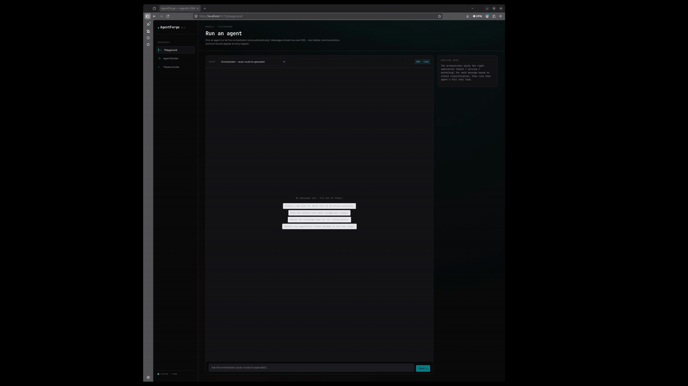

# AgentForge

> An open-source agentic CRM platform — author custom AI agents, equip them with CRM tools, and route requests to specialists via a multi-agent orchestrator. React + TypeScript + GraphQL on top of a Python agent runtime that streams reasoning over SSE. Deployed on **NVIDIA DGX Spark serving Google's Gemma 4 26B-A4B (MoE, NVFP4) via vLLM**.

## Demo

Live agentic round trip on Gemma 4 + DGX Spark: orchestrator classifies the request → routes to the Sales SDR agent → Gemma 4 generates a structured tool call → AgentForge dispatches `create_lead` to SQLite → a natural-language summary streams back. **End-to-end in ~1.1 seconds.**



AgentForge is a from-scratch take on Salesforce's Agentforce: a workbench where you can author agents (system prompt + tools + guardrails), test them in a streaming playground, route to them via a classifier-driven orchestrator, and evaluate them against a fixture suite. The agent runtime is provider-agnostic — the same code targets Anthropic's API, a self-hosted vLLM endpoint, or a deterministic mock used for tests.

---

## What this exercises

A single project that touches every layer of a real agent platform:

- A polished React/TypeScript frontend that streams agent reasoning live (text deltas + tool calls + tool results interleaved)
- A typed GraphQL API for state (agents, traces, tools, eval reports)
- A streaming agent loop with structured tool calling, guardrails, and per-run trace persistence
- A multi-agent orchestrator that classifies requests into specialist sub-agents
- An offline evaluation harness with LLM-as-judge scoring
- A real on-prem GPU deployment: Gemma 4 26B-A4B NVFP4 on a single NVIDIA DGX Spark (GB10, sm_121, 128 GB unified memory), served by vLLM with native tool calling

The code is intentionally readable: ~3k LOC of Python + ~1.5k LOC of TypeScript, no clever DSLs, every architectural seam documented inline.

---

## What's in the box

| Layer | Stack | Highlights |
|---|---|---|
| **Frontend** | React 18 · TypeScript (strict) · Vite · Apollo Client · pure CSS | Streaming playground using native `EventSource`, agent CRUD via GraphQL mutations, eval dashboard, trace inspector |
| **API** | FastAPI · Strawberry GraphQL · Server-Sent Events | GraphQL for state, SSE for streaming chat |
| **Agent runtime** | Python 3.11+ · async/await · Pydantic | Provider-agnostic LLM streaming, structured tool registry, guardrails, trace persistence, timeouts and tool-call caps |
| **LLM providers** | Anthropic SDK · vLLM (OpenAI-compatible) · deterministic Mock | Swap with one env var |
| **Tools** | Pydantic-validated args, JSON-schema auto-derived | 7 CRM tools wired to the database (`create_lead`, `find_contact`, `find_account`, `advance_opportunity_stage`, `draft_email`, `search_knowledge_base`, `summarize_account_history`) |
| **Persistence** | SQLAlchemy 2.0 async · SQLite (dev) / Postgres (prod) | Mock CRM seeded with accounts, contacts, opportunities, leads |
| **Evaluation** | Custom harness · LLM-as-judge | Fixture replay → tool-accuracy, text-match, p50/p95 latency, optional judge score |
| **Tests** | Pytest async · 11 cases | Tool dispatch · runtime end-to-end · eval harness · hallucinated-tool resilience |

---

## Live deployment: Gemma 4 26B-A4B NVFP4 on DGX Spark

The platform runs end-to-end against a real Gemma 4 instance on a single NVIDIA DGX Spark. Concretely:

- **Hardware:** NVIDIA GB10 GPU (Blackwell, sm_121), 128 GB unified LPDDR5X memory, 273 GB/s bandwidth, ARM64 Grace CPU
- **Model:** `bg-digitalservices/Gemma-4-26B-A4B-it-NVFP4` — Google's Gemma 4 MoE (26B total / 4B active per token), NVFP4-quantized for Blackwell tensor cores
- **Serving stack:** `vllm/vllm-openai:gemma4-cu130` Docker image, vLLM 0.19, CUDA 13.0
- **Inference config:** FLASHINFER_CUTLASS backend for dense layers, MARLIN backend for the MoE (required on sm_121 — native FP4 MoE kernels aren't available yet), FP8 KV cache, 32K context window, prefix caching + chunked prefill enabled
- **Tool calling:** `--tool-call-parser gemma4` (native Gemma 4 tool-call tokens, OpenAI-compatible JSON output)
- **Reasoning mode:** `--reasoning-parser gemma4`

### Observed performance

On the DGX Spark used for this build:

- **First token latency:** ~50 ms after warm cache
- **Single-stream throughput:** ~50 tok/s (close to the bandwidth ceiling for 4B active params at FP4 on 273 GB/s)
- **End-to-end tool-calling round trip:** ~1.1 s for a simple `create_lead` request (orchestrator classification → Gemma 4 tool call → SQLite write → natural-language summary streamed back)
- **Per-tool dispatch overhead:** 2–3 ms (Pydantic validation + async SQLAlchemy)

### Example trace

Live SSE output for `"Create a lead for Sarah Chen at Hexagon Labs"`:

```
event: text_delta    → "[orchestrator] routed to: sales (Sales SDR)\n"
event: tool_call     → name=create_lead, arguments={"first_name":"Sarah","last_name":"Chen","company":"Hexagon Labs"}
event: tool_result   → ok=true, data={id:"4070c636-...", status:"new"}, duration_ms=2.9
event: text_delta    → "I've successfully created a new lead for Sarah Chen at Hexagon Labs (Lead ID: 4070c636-...)."
event: done          → trace_id="3f42d7c9-...", duration_ms=1114
```

Every span — orchestrator routing, tool dispatch, tool result, natural-language summary — is persisted as a `Trace` with structured `ToolCallRecord` children, queryable via GraphQL.

---

## Architecture

```
┌──────────────────────────────────────────────────────────────────┐
│  Browser                                                         │
│  ┌──────────────────┐   ┌──────────────────┐   ┌──────────────┐  │
│  │  Playground       │  │  Agent Builder    │  │ Traces+Evals │  │
│  │  (SSE EventSource)│  │  (Apollo / GQL)   │  │ (Apollo /GQL)│  │
│  └─────────┬─────────┘   └────────┬─────────┘   └──────┬───────┘  │
└────────────┼──────────────────────┼─────────────────────┼─────────┘
             │ /chat/{id}           │ /graphql            │ /graphql
             │ /chat/orchestrate    │                     │
┌────────────▼──────────────────────▼─────────────────────▼─────────┐
│  FastAPI                                                          │
│  ┌──────────────┐   ┌─────────────┐   ┌────────────────────────┐  │
│  │ SSE chat     │   │ GraphQL     │   │ /admin/reset, /healthz │  │
│  │ (sse-starlette)│ │ (Strawberry)│   │                        │  │
│  └──────┬───────┘   └──────┬──────┘   └────────────────────────┘  │
└─────────┼──────────────────┼──────────────────────────────────────┘
          │                  │
┌─────────▼──────────────────▼──────────────────────────────────────┐
│  Agent Runtime  (run_agent)                                        │
│   ─ stream LLM events                                              │
│   ─ dispatch tool calls (registry → Tool.execute)                  │
│   ─ enforce timeout + tool-call cap                                │
│   ─ persist Trace + ToolCallRecord                                 │
└──┬─────────────────────────────────────┬───────────────────────────┘
   │                                     │
┌──▼───────────────────┐         ┌──────▼──────────────────────────┐
│  LLM provider        │         │  Tool registry                   │
│   ─ MockLLMClient    │         │   ─ 7 CRM tools, Pydantic args   │
│   ─ AnthropicLLM     │         │   ─ JSON schema auto-derived     │
│   ─ VLLMClient ◄─────┼─────────►   ─ guardrails enforced          │
│       (Gemma 4 on    │         │   ─ ToolContext (db, agent,      │
│        DGX Spark)    │         │      trace_id, guardrails)       │
└──────────────────────┘         └──────────────────────────────────┘
                                          │
                                ┌─────────▼─────────────────────────┐
                                │  SQLAlchemy 2.0 async             │
                                │   ─ accounts, contacts, leads,    │
                                │     opportunities, activities     │
                                │   ─ agent_definitions, traces,    │
                                │     tool_calls                    │
                                └───────────────────────────────────┘
```

### Key design decisions

- **GraphQL for state, SSE for streams.** GraphQL subscriptions over WebSocket were overkill for v0. SSE is one HTTP GET, falls back gracefully, and is trivial to consume from `EventSource` in the browser.
- **Provider-agnostic LLM interface.** The `LLMClient` ABC emits a small set of events (`TextDelta`, `ToolCallRequest`, `TurnEnd`). Each provider adapter translates its native streaming format into these events. The runtime never imports a vendor SDK directly. Adding a new provider is ~150 lines.
- **Format translation in the adapter, not the runtime.** Internally the runtime uses Anthropic-style content blocks (text + tool_use). The Anthropic adapter passes them through; the vLLM adapter translates to OpenAI's `tool_calls` array format. This kept the runtime simple while supporting both ecosystems cleanly.
- **Tools are classes, not config.** Each tool subclasses `Tool`, declares a Pydantic `Args` model, and implements `run`. JSON schema is derived from the Args model so the LLM's tool-use payload is always validated. Errors become structured tool-error messages back to the model rather than crashing the loop.
- **Guardrails ride on the agent definition.** Stored as a JSON object (`max_amount`, `blocked_companies`, etc.) and read by tools at execution time via `ToolContext.guardrails`. Adding a new constraint is one line in the tool's `run` method.
- **Trace-first.** Every run persists a `Trace` skeleton up front, fills it in as events stream, and finalises status on completion. Even errored runs are auditable. The eval harness is just trace replay with assertions.

---

## Quick start (local)

Requires Python 3.11+, Node 18+. By default uses the deterministic mock LLM — no API key or GPU required.

```bash
# 1. Backend
cd backend
python -m venv .venv && source .venv/bin/activate
pip install -e ".[dev]"
python -m app.seed                    # creates agentforge.db with mock CRM
uvicorn app.main:app --reload         # http://localhost:8000

# 2. Frontend (in a second terminal)
cd frontend
npm install
npm run dev                           # http://localhost:5173
```

Open `http://localhost:5173`. The playground will stream sensible canned responses with real tool calls against the seeded SQLite database.

### Switching to a real model

```bash
# Anthropic
export LLM_PROVIDER=anthropic
export ANTHROPIC_API_KEY=sk-ant-...

# vLLM (any OpenAI-compatible endpoint — Gemma 4, Llama, Qwen, etc.)
export LLM_PROVIDER=vllm
export VLLM_BASE_URL=http://your-host:8001/v1
export VLLM_MODEL=gemma-4-26b
```

Restart the backend.

### Running tests

```bash
cd backend
python -m pytest -q
# 11 passed in 1.83s
```

---

## Deployment: Gemma 4 26B-A4B NVFP4 on DGX Spark

Documented end-to-end so anyone with a Spark can reproduce.

### Prerequisites

- DGX Spark with the NVIDIA Container Toolkit installed (CUDA 13.0, driver 580+)
- ~50 GB free disk (16 GB model weights + ~20 GB container image)
- HuggingFace account with Gemma license acceptance at `huggingface.co/google/gemma-4-26B-A4B-it`
- Docker access (`sudo usermod -aG docker $USER && newgrp docker`)

### Pull the model and container

```bash
mkdir -p ~/models
export HF_TOKEN=hf_...

pipx install "huggingface_hub[cli]"
hf auth login --token $HF_TOKEN
hf download bg-digitalservices/Gemma-4-26B-A4B-it-NVFP4 \
  --local-dir ~/models/gemma4-26b-a4b-nvfp4

docker pull vllm/vllm-openai:gemma4-cu130
```

### Launch vLLM

```bash
docker run -d \
  --name gemma4-nvfp4 --restart unless-stopped \
  --gpus all --ipc=host --shm-size=64g \
  -p 8001:8000 \
  -v ~/models/gemma4-26b-a4b-nvfp4:/models/gemma4 \
  -v ~/models/gemma4-26b-a4b-nvfp4/gemma4_patched.py:/usr/local/lib/python3.12/dist-packages/vllm/model_executor/models/gemma4.py:ro \
  vllm/vllm-openai:gemma4-cu130 \
  --model /models/gemma4 \
  --served-model-name gemma-4-26b \
  --host 0.0.0.0 --port 8000 \
  --quantization modelopt \
  --kv-cache-dtype fp8 \
  --max-model-len 32768 \
  --gpu-memory-utilization 0.85 \
  --moe-backend marlin \
  --enable-prefix-caching --enable-chunked-prefill \
  --max-num-seqs 16 \
  --enable-auto-tool-choice \
  --tool-call-parser gemma4 \
  --reasoning-parser gemma4
```

Two flags are non-obvious and easy to get wrong on Spark:

- **`--moe-backend marlin`** — required on sm_121. The default FlashInfer CUTLASS MoE backend produces NaN scale factors and garbage output on GB10 because native FP4 MoE kernels aren't compiled for this compute capability. Marlin decompresses FP4 → BF16 at runtime; slower than native W4A4 but correct.
- **The mounted `gemma4_patched.py`** — the community NVFP4 checkpoint uses a fused 3D expert tensor format that vLLM's stock `gemma4.py` can't load. The patch (~50 KB) ships with the model repo and fixes the `expert_params_mapping` so the NVFP4 scale keys map correctly to FusedMoE parameter names.

Startup takes ~90 seconds for weight load + CUDA graph capture. Healthy boot log should show:

```
INFO Using NvFp4LinearBackend.FLASHINFER_CUTLASS for NVFP4 GEMM
INFO Using 'MARLIN' NvFp4 MoE backend
INFO Multi-modal warmup completed in 11.331s
INFO Application startup complete.
```

If you see `CUTLASS_FP4` instead of `MARLIN` for MoE, the flag didn't take — stop and restart with the flag explicit.

### Point AgentForge at it

```bash
export LLM_PROVIDER=vllm
export VLLM_BASE_URL=http://localhost:8001/v1
export VLLM_MODEL=gemma-4-26b
uvicorn app.main:app --reload
```

---

## Evaluation

Run the suite from the UI (Traces & Evals → "Run eval suite") or from Python:

```python
from app.eval import load_cases, run_eval
from app.db import session_scope

cases = load_cases("traces/sample_traces.json")
async with session_scope() as db:
    report = await run_eval(db=db, cases=cases, use_judge=True)
print(report.tool_accuracy, report.p95_latency_ms)
```

The fixture in `traces/sample_traces.json` contains 8 cases across the Sales SDR and Customer Service agents. Each case asserts the expected tool fired; with `use_judge=True`, an LLM scores final-answer quality 0–1 against the case rubric.

---

## Project layout

```
agentforge/
├── backend/
│   ├── app/
│   │   ├── main.py              FastAPI app · GraphQL mount · SSE chat endpoints
│   │   ├── config.py            Pydantic settings (env-driven)
│   │   ├── db.py                Async SQLAlchemy session factory
│   │   ├── seed.py              Mock CRM + 3 default specialist agents
│   │   ├── models/              ORM: CRM (Account/Contact/Lead/Opp/Activity) + agent (AgentDefinition/Trace/ToolCallRecord)
│   │   ├── agents/
│   │   │   ├── runtime.py       The streaming agent loop
│   │   │   ├── orchestrator.py  Multi-agent classifier + dispatch
│   │   │   ├── llm/             Provider adapters: base, mock, anthropic, vllm
│   │   │   └── tools/           Tool ABC + 7 CRM tools, auto-registered
│   │   ├── eval/harness.py      Trace replay + LLM-as-judge
│   │   └── graphql/             Strawberry types, queries, mutations, schema
│   └── tests/                   11 tests · runtime · tools · eval
├── frontend/
│   └── src/
│       ├── App.tsx              Sidebar + routes
│       ├── apollo.ts            Apollo client
│       ├── graphql/operations.ts
│       ├── components/
│       │   ├── ChatStream.tsx   SSE consumer · interleaves text + tool cards
│       │   └── ToolCallCard.tsx
│       ├── pages/
│       │   ├── Playground.tsx   The headline view
│       │   ├── AgentBuilder.tsx GraphQL CRUD
│       │   └── TracesEval.tsx   Eval runner + trace browser
│       └── styles.css           Dev-console aesthetic, JetBrains Mono + Manrope
├── docs/
│   └── demo.gif                 Live demo: orchestrator → tool call → SQL write → LLM summary
└── traces/
    └── sample_traces.json       Eval fixtures
```

---

## Sharp edges hit during the build

A handful of bugs caught and fixed in development, kept here so the next person doesn't waste time on them:

1. **FastAPI route ordering** — `/chat/{agent_id}` declared before `/chat/orchestrate` causes the orchestrator request to match the agent-id pattern (treating `"orchestrate"` as a literal agent ID). Fix: declare literal paths before parameterised ones.
2. **vLLM message format translation** — the agent runtime uses Anthropic-style content blocks internally; vLLM's OpenAI-compatible endpoint expects a string `content` field plus a separate `tool_calls` array on assistant messages. The translation has to happen in the vLLM adapter, not the runtime.
3. **AsyncSession is not concurrent-safe** — running multiple eval cases against a shared SQLAlchemy session caused intermittent corruption. Fix: each case opens its own session.
4. **`tool-call-parser` on Gemma 4** — the `pythonic` parser leaks `<|tool_call|>` raw tokens into text deltas instead of structured tool calls. Use `gemma4` for the `bg-digitalservices` NVFP4 checkpoint.
5. **MoE backend on GB10** — the default FlashInfer CUTLASS backend silently produces garbage output for NVFP4 MoE layers on sm_121. Use `--moe-backend marlin`.

---

## Roadmap

- Postgres migration (Alembic) and Docker Compose for one-command local stack
- Replace toy keyword search with embedding-based retrieval (pgvector)
- Tensor-parallel across two Sparks via ConnectX-7 for larger models (Qwen 3.5 397B, GLM-5, etc.)
- WebSocket transport for bidirectional streaming (interrupt mid-turn)
- Per-agent metrics dashboard (token usage, cost, tool error rate over time)
- Tool authoring from the UI (declare a Pydantic schema visually)
- Add `human_in_the_loop` tool that pauses the loop awaiting approval

---

## License

MIT — see [LICENSE](LICENSE) for the full text. Copyright (c) 2026 Yin Su.
